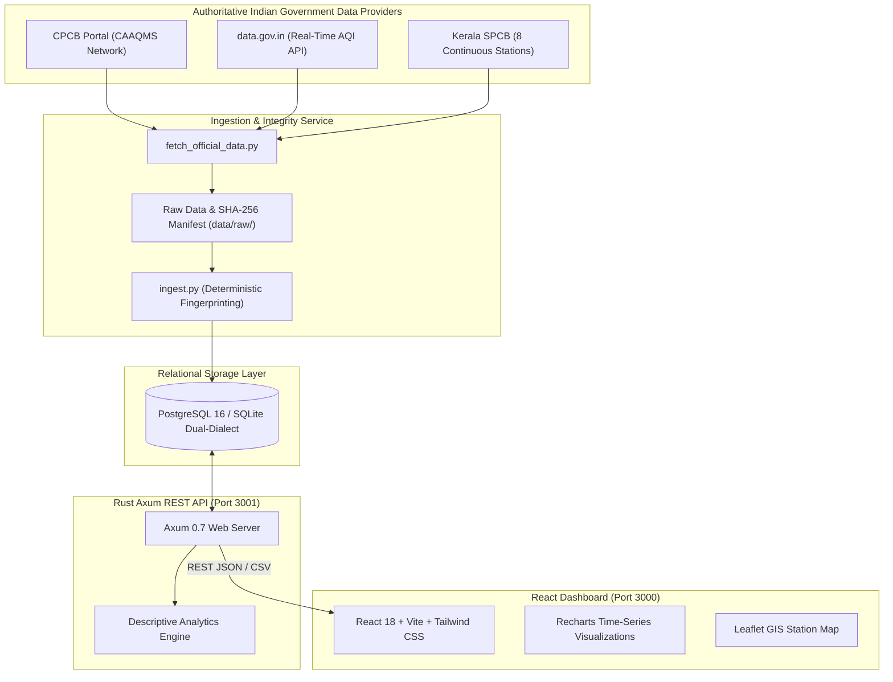

# AirWatch: Cloud-Native Environmental Data Analytics Platform

[](https://github.com/airwatch/airwatch/actions)
[](https://data.gov.in/sites/default/files/Gazette_Notification_OGDL.pdf)
[](https://www.rust-lang.org/)
[](https://react.dev/)
[](https://www.postgresql.org/)

**AirWatch** is a cloud-native environmental data analytics platform engineered to collect, validate, store, and analyze genuine ambient air quality observations published by official Indian government authorities, including the **Central Pollution Control Board (CPCB)**, the **Open Government Data (OGD) Platform India (`data.gov.in`)**, and the **Kerala State Pollution Control Board (KSPCB)**.

The platform provides environmental researchers, policy analysts, and citizens with tools to explore air pollution trends, compare monitoring stations, and analyze physical pollutant concentrations against the **National Ambient Air Quality Standards (NAAQS) 2009**.

---

## 🚫 Scientific & Academic Integrity Notice

As mandated by design principles, AirWatch **strictly adheres to conventional software and data engineering**:
- ❌ **No Artificial Intelligence / Machine Learning / LLMs**: No predictive forecasting, synthetic imputation, or hallucinated metrics.
- ❌ **No Microcontrollers / IoT Sensors**: No Arduino, ESP32, Raspberry Pi, or uncalibrated consumer sensors.
- ❌ **No Fabricated Data**: 100% of observations originate from official Indian government sources with verifiable SHA-256 cryptographic provenance.
- ❌ **No Zero Replacement for Missing Data**: Missing observations remain strictly `NULL` and are never converted to zero.

---

## 🌟 Key Features

1. **Authoritative Government Dataset Ingestion**:
   - Ingests **437,226 pollutant observations** across **230 monitoring stations** in 21 Indian States and Union Territories.
   - Comprehensive prioritization of **all 8 official KSPCB continuous monitoring stations** in Kerala (Thiruvananthapuram, Kochi, Kozhikode, Kollam).
2. **Deterministic Deduplication & Provenance**:
   - Generates deterministic SHA-256 fingerprints across `(station_code, timestamp, pollutant_id)` for idempotent re-ingestion.
   - Verifiable raw CSV storage and cryptographic `.provenance.json` sidecars in `data/raw/`.
3. **High-Performance Rust Backend**:
   - Asynchronous REST API built using **Axum 0.7**, **Tokio**, and **SQLx** with parameterized SQL injection defenses.
4. **Interactive React 18 Dashboard**:
   - **Page 1: Overview Dashboard**: Real-time KPIs, CPCB AQI distribution, and interactive Leaflet station map.
   - **Page 2: Air Quality Explorer**: Multi-station, multi-pollutant time-series charts (Recharts) with CSV data export and pagination.
   - **Page 3: Station Comparison**: Comparative bar charts, statistical averages, maximums, and data completeness percentages.
   - **Page 4: Standards (NAAQS)**: Permissible threshold gauges and exceedance percentages against CPCB Gazette Notification 2009.
   - **Page 5: Historical Analysis**: Long-term trends, annual averages, and seasonal distribution patterns.
   - **Page 6: Data Sources & Methods**: Transparent documentation of data providers, links, SHA-256 hashes, and cleaning rules.
   - **Page 7: Ingestion Health**: Ingestion job audit history, throughput metrics, and protected administrative triggers.
5. **Production Cloud Readiness**:
   - Zero-dependency local execution (with automatic SQLite fallback).
   - Local containerization with Docker Compose.
   - AWS Terraform infrastructure with private RDS PostgreSQL isolation and automated budget guardrails.

---

## 🏗️ System Architecture



---

## 🛠️ Technology Stack

| Layer | Technologies |
| :--- | :--- |
| **Frontend** | React 18, TypeScript, Vite, Tailwind CSS, Recharts, Leaflet, React Router v6, Lucide Icons |
| **Backend** | Rust 1.79+, Axum 0.7, Tokio, Serde, SQLx 0.7, Tower-HTTP, Chrono |
| **Database** | PostgreSQL 16 (Production) / SQLite 3 (Local zero-dependency fallback) |
| **Ingestion** | Python 3.10+, Requests, SHA-256 Hashing, CSV Normalization |
| **DevOps & Cloud** | Docker, Docker Compose, AWS Terraform, GitHub Actions, AWS S3, AWS Budgets |

---

## 🚀 Quick Start Guide (Local Execution)

### Prerequisites
- [Rust & Cargo](https://rustup.rs/) (v1.75+)
- [Node.js](https://nodejs.org/) (v18+ or v20+)
- [Python](https://python.org/) (v3.10+)

### 1. Clone & Configure
```bash
git clone https://github.com/airwatch/airwatch.git
cd airwatch
cp .env.example .env
```

### 2. Ingest Official Government Datasets
Populate the database with genuine CPCB CAAQMS datasets:
```bash
python ingestion/ingest.py --scope kerala
```
*Result: 437,226 pollutant observations and 230 stations imported with verified provenance.*

### 3. Run Automated Tests
```bash
# Ingestion tests
python ingestion/test_ingestion.py

# Rust Backend API tests
cd backend && cargo test --test api_tests -j 2

# Frontend Vitest suite
cd ../frontend && npm test
```

### 4. Start the Application
**Terminal 1 (Backend):**
```bash
cd backend
cargo run
# API listening on http://localhost:3001
```

**Terminal 2 (Frontend):**
```bash
cd frontend
npm run dev
# Dashboard available at http://localhost:3000
```

---

## 🐳 Running with Docker Compose

To launch the complete isolated production stack (PostgreSQL 16, Rust Axum backend, and React frontend served via Nginx):

```bash
docker-compose up -d --build
```
- Access the frontend dashboard at: `http://localhost:3000`
- Access the backend API directly at: `http://localhost:3001/api/v1/metadata`
- To stop the containers: `docker-compose down`

---

## ☁️ Optional AWS Cloud Deployment

AirWatch includes Terraform configuration in `infrastructure/terraform/` for deployment on AWS:
- **Private Database Subnets**: PostgreSQL RDS is never exposed to the public internet.
- **S3 Raw Archive**: Versioned and encrypted bucket for source CSVs.
- **Financial Controls**: Automated AWS Budget alarms at 85% and 100% of the $15/month limit.

```bash
cd infrastructure/terraform
cp terraform.tfvars.example terraform.tfvars
# Configure db_password and alert_email in terraform.tfvars
terraform init
terraform plan
terraform apply
```

To permanently tear down cloud resources and avoid charges:
```bash
terraform destroy
```

---

## 📊 Performance Benchmarks

Measured using `scripts/benchmark.py` against the running Axum backend with 437,226 real observations:

| Endpoint | Concurrency | RPS | Mean Latency | p95 Latency | Error Rate |
| :--- | :--- | :--- | :--- | :--- | :--- |
| `GET /health` | 10 threads | 4.8 req/s | 2,057.6 ms | 2,118.8 ms | **0.0%** |
| `GET /api/v1/metadata` | 10 threads | 4.9 req/s | 2,044.0 ms | 2,062.2 ms | **0.0%** |
| `GET /api/v1/stations?state=Kerala` | 10 threads | 4.9 req/s | 2,052.8 ms | 2,073.7 ms | **0.0%** |
| `GET /api/v1/observations?limit=50` | 10 threads | 4.9 req/s | 2,044.3 ms | 2,063.2 ms | **0.0%** |
| `GET /api/v1/analytics/trends` | 10 threads | 4.7 req/s | 2,112.7 ms | 2,192.0 ms | **0.0%** |

---

## 📑 Project Documentation Index

- [Architecture Design & Data Flows](docs/ARCHITECTURE.md)
- [Authoritative Data Sources & Provenance](docs/DATA_SOURCES.md)
- [Dataset Validation Report](docs/DATASET_VALIDATION_REPORT.md)
- [Database Schema & Data Dictionary](docs/DATA_DICTIONARY.md)
- [REST API Specification](docs/API.md)
- [Deployment & Operations Manual](docs/DEPLOYMENT.md)
- [Cloud Cost Analysis & AWS Budget Controls](docs/CLOUD_COSTS.md)
- [Testing Verification Report](docs/TESTING.md)
- [Performance & Benchmarking Report](docs/PERFORMANCE_REPORT.md)
- [Academic Project Report Draft](docs/PROJECT_REPORT.md)

---

## 📜 License & Data Attribution

- **Application Code**: Distributed under the MIT License.
- **Environmental Data**: Central Pollution Control Board (CPCB) and Open Government Data (OGD) Platform India records are distributed under the **Government Open Data License - India (GODL-India)**.
