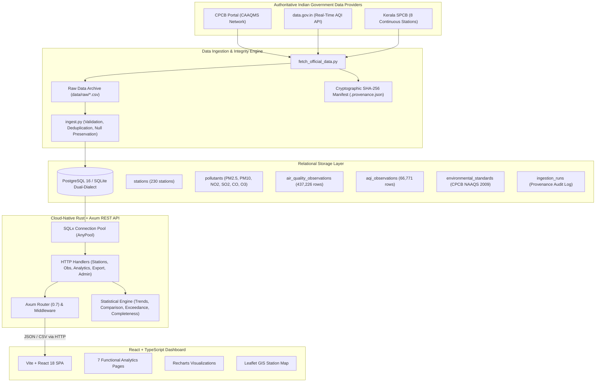

# AirWatch System Architecture Documentation

## 1. System Overview & Problem Statement

AirWatch is a cloud-native environmental data analytics platform engineered to ingest, validate, store, and analyze genuine air-quality observations published by official Indian government authorities, specifically the Central Pollution Control Board (CPCB), Open Government Data (OGD) Platform India (`data.gov.in`), and the Kerala State Pollution Control Board (KSPCB).

### Non-Goals & Integrity Constraints
As mandated by the system specification:
- **Zero Artificial Intelligence / Machine Learning**: No neural networks, generative AI, LLMs, or speculative predictive models are employed.
- **Zero Embedded Sensors / IoT Simulators**: No Arduino, ESP32, Raspberry Pi, or synthetic telemetry.
- **Zero Fabricated Environmental Observations**: Observations displayed in the platform originate strictly from published government records with complete cryptographic provenance.

---

## 2. Logical Architecture Diagram

---

## 3. Component Responsibilities

### 3.1 Data Ingestion Service (`ingestion/`)
- **Data Acquisition**: Retrieves published CPCB CAAQMS datasets and queries the `data.gov.in` real-time API (Resource ID `3b01bcb8-0b14-4abf-b6f2-c1bfd384ba69`) when API keys are configured.
- **Raw Archive & Integrity**: Computes SHA-256 checksums for every incoming payload and stores original files verbatim in `data/raw/` accompanied by `.provenance.json` sidecars.
- **Validation & Cleaning**:
  - Validates ISO-8601 timestamps and calendar boundaries.
  - Rejects impossible sensor readings (e.g., negative concentrations for PM or values exceeding physical sensor saturation).
  - Preserves nulls: unrecorded sensor measurements are **never** silently converted to zero.
- **Deterministic Deduplication**: Generates deterministic SHA-256 fingerprints across `(station_code, observation_timestamp, pollutant_id)` ensuring exact idempotency during re-ingestion.

### 3.2 Database Layer (`database/`)
- Relational schema with strict foreign key constraints, check constraints, and B-tree indexes.
- Separation of reported AQI index values from raw physical pollutant concentrations (`µg/m³` and `mg/m³`).
- Pre-populated with official Central Pollution Control Board National Ambient Air Quality Standards (NAAQS) Gazette Notification 2009.

### 3.3 Backend REST API (`backend/`)
- High-performance, memory-safe asynchronous web server written in **Rust** using **Axum 0.7**, **Tokio**, and **SQLx**.
- **RESTful Endpoints**:
  - Health and telemetry: `/health`, `/ready`, `/api/v1/metadata`, `/api/v1/data-status`
  - Stations directory and metadata: `/api/v1/stations`, `/api/v1/stations/:id`
  - Observations: `/api/v1/observations`, `/api/v1/observations/latest`, `/api/v1/observations/history`
  - Descriptive analytics: `/api/v1/analytics/trends`, `/api/v1/analytics/station-comparison`, `/api/v1/analytics/pollutant-summary`, `/api/v1/analytics/exceedances`, `/api/v1/analytics/data-completeness`
  - Data export: `/api/v1/export/observations.csv`
  - Administrative ingestion tracking: `/api/v1/admin/ingestion-runs`
- **Security**: Parameterized queries prevent SQL injection; administrative triggers require `X-Admin-Key` header authentication; database credentials are never leaked to clients.

### 3.4 Frontend Dashboard (`frontend/`)
- Single Page Application built with **React 18**, **TypeScript**, and **Tailwind CSS**.
- **7 Fully Interactive Pages**:
  1. *Overview Dashboard*: System-wide telemetry, station counts, interactive Leaflet map, and latest AQI breakdown.
  2. *Air Quality Explorer*: Multi-parameter filterable time-series charts (Recharts) with CSV data export and pagination.
  3. *Station Comparison*: Side-by-side comparative bar charts, sample sizes, and data completeness metrics.
  4. *Standards (NAAQS)*: Descriptive exceedance counts and percentage violation bars against CPCB 2009 standards.
  5. *Historical Analysis*: Long-term trends, annual averages, and seasonal distribution patterns.
  6. *Data Sources & Methodology*: Comprehensive transparency documentation, dataset URLs, SHA-256 checksums, and provenance policies.
  7. *Ingestion Monitoring*: Real-time audit log of ingestion jobs, records processed, error rates, and manual trigger controls.

---

## 4. Failure Handling & Offline Resilience

1. **External Source Outage**:
   - When external government portals (`data.gov.in` or CPCB) undergo maintenance or experience rate limiting, AirWatch automatically serves the historical and verified dataset stored locally without degrading query capabilities.
2. **Database Resilience**:
   - Connection pool timeout handling (`acquire_timeout = 30s`) and SQLite WAL (Write-Ahead Logging) mode support concurrent reading threads without database locking.
3. **Graceful Shutdown**:
   - The Rust Axum server listens for OS `SIGINT` (Ctrl+C) and `SIGTERM` signals, completing in-flight HTTP requests before closing connection pools.
